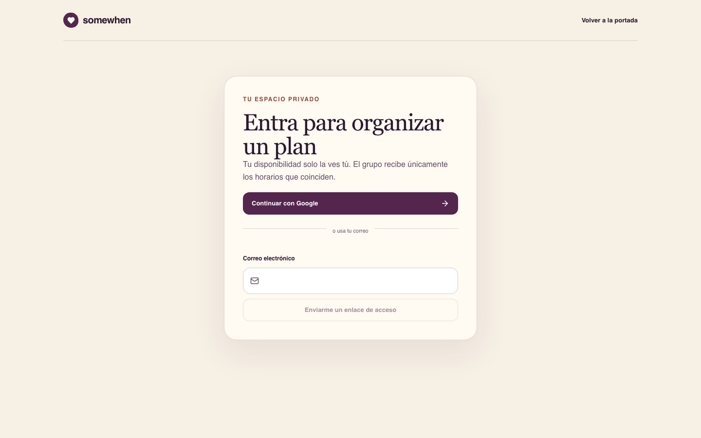

# Somewhen

> 🇬🇧 **In English:** Somewhen helps a group find a shared time slot without exposing anyone's private calendar. Next.js + Supabase with row-level security, OAuth and Realtime.

Somewhen ayuda a un grupo a encontrar un horario compartido sin exponer la agenda privada de ninguna persona. La aplicación conserva el flujo abierto de propuesta —idea, integrantes, lugar opcional, calendario real y revisión— y ahora persiste el proceso completo en Supabase.

## Capturas


<p align="center"> </p>

## Qué funciona

- acceso con Google OAuth y enlace mágico por correo;
- sesiones SSR en cookies y rutas `/app` y `/join` protegidas;
- perfiles, grupos e invitaciones con token hasheado, vencimiento y límite de usos;
- disponibilidad privada que solo puede leer y editar su propietaria o propietario;
- cálculo de coincidencias mediante un RPC que valida pertenencia al grupo;
- propuestas inmutables con integrantes seleccionados;
- aceptación unánime, sugerencias separadas y actualizaciones Realtime; y
- RLS y privilegios explícitos en todas las tablas expuestas.

La aplicación nunca usa ni necesita una clave `service_role`.

## Requisitos

- Node.js `>=22.13.0`
- Docker, solo para ejecutar Supabase localmente
- Un proyecto de Supabase para el entorno desplegado

## Configuración local

```bash
npm install
cp .env.example .env.local
npm run db:start
npm run db:reset
npm run dev
```

Completa `.env.local` con el URL y la clave publicable del proyecto. El archivo está ignorado por Git; `.env.example` solo documenta los nombres esperados.

La migración imperativa vive en `supabase/migrations/20260804231023_create_somewhen_mvp.sql`. `npm run db:reset` la aplica únicamente a la instancia local.

## Configuración externa en Supabase

Antes de usar un proyecto remoto:

1. Aplica la migración revisada con Supabase MCP o el flujo de migraciones del equipo.
2. En **Authentication > URL Configuration**, define el Site URL y agrega como redirect exacto `https://tu-dominio/auth/callback`.
3. En **Authentication > Providers**, habilita Google y configura sus credenciales OAuth. Agrega el callback de Supabase indicado por el panel a Google Cloud.
4. Mantén Email habilitado para el acceso por enlace mágico. En producción configura SMTP propio y revisa la plantilla.
5. Confirma que `public` esté entre los schemas expuestos por Data API. La migración concede privilegios explícitos a `authenticated`; `anon` no recibe acceso a datos.

## Verificación

```bash
npm run lint
npm run build
npm test
npm run db:test
```

- `npm test` compila y ejecuta pruebas de dominio, rutas renderizadas y controles estáticos de seguridad SQL.
- `npm run db:test` reinicia la base local y ejecuta `supabase/tests/security.sql`, que falla si falta RLS, se filtran invitaciones o hay funciones privadas ejecutables por `PUBLIC`.

## Estructura relevante

- `app/login/` — Google OAuth y enlace mágico.
- `app/auth/callback/route.ts` — intercambio PKCE de código por sesión.
- `proxy.ts` — renovación de cookies y respuestas privadas/no-cache.
- `app/app/workspace.tsx` — grupos, disponibilidad, propuestas, respuestas y sugerencias.
- `lib/supabase/` — clientes independientes por solicitud y cliente del navegador.
- `supabase/migrations/` — esquema, RPCs, RLS, grants y publicación Realtime.
- `supabase/tests/security.sql` — verificaciones ejecutables contra PostgreSQL.

El scaffolding anterior de D1/Drizzle se retiró para evitar dos fuentes de persistencia.
